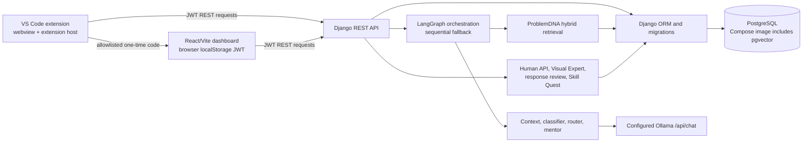

# NEXUS architecture

## Current architecture (repository inspection)

Evidence: `NEXUS Extension/extension.js`, `NEXUS Extension/package.json`, `Frontend/src/App.jsx`, `Frontend/src/services/api.js`, `Backend/config/urls.py`, `Backend/ai/orchestrator/graph.py`, `Backend/ai/llm/client.py`, and the Django apps under `Backend/apps/`.

## Existing versus planned

| Component | Current state | Target work |
| --- | --- | --- |
| VS Code extension | Sidebar webview, login/token storage, selection analysis, follow-up, expert controls, dashboard URL command. | Advanced mode now offers explicit file-name selection and read approval, bounded to five files; local conversation history/switching are implemented in webview state; extension-host code context and automated Extension Host tests remain. |
| Web dashboard | React/Vite protected routes for analytics, problem history, learning, users, Human API and Visual Expert. Browser stores its JWT in localStorage. | Durable chat, theme controls, finish removing sample analytics and expand governance views. |
| Backend/auth | Django REST, SimpleJWT, custom user model, domain apps. Core NEXUS and ProblemDNA APIs require authentication and ownership checks. Dashboard exchange codes are hashed, short-lived, single-use and callback-bound. | Corporate identity-provider SSO, revocation policy and deployment security hardening remain. |
| AI | Local/configurable Ollama client; LangGraph graph and sequential fallback; specialist prompts and sanitizer. | Guided troubleshooting evaluations, actionable safe service errors, preserve generators for explicitly requested artifact workflows. |
| Retrieval | ProblemDNA records; Ollama embeddings are stored as JSON and cosine-ranked with keyword, language, category and verification signals. Missing embeddings use keyword fallback. | Run the backfill command after approving records; validate model quality and retrieval relevance on representative data. |
| Human API/review | Expert and developer dashboard experiences, profile discovery/self-service skills and availability, opt-in context share, request cancellation, private messages, feedback, reviews, and metadata-only audit events. Chat and request lists poll every three seconds. | WebSocket/push notifications, background expiry, production hardening and deployment review remain. |
| Visual Expert | Dashboard route and extension entry point use administrator-curated, approved knowledge records with explicit source selection, AI disclosure, citations, and source review controls. | Automatic company Git ingestion remains blocked on approved host/repository/access/retention details. |
| Skill Quest | Repeated category based recommendations and progress. | Curated, reviewed learning catalogue and evidence/feedback workflow; internal course data must be supplied. |
| PostgreSQL/pgvector | PostgreSQL ORM; embeddings are portable JSON arrays and cosine similarity is calculated in the backend. Compose still includes pgvector for compatibility, but current semantic lookup does not require it. | Keep PostgreSQL authoritative; consider pgvector indexing only if measured data size justifies it. |
| Storage/jobs/graph | No object store, scheduled worker, broker or knowledge graph found. | Continue using relational models until a specific requirement justifies another service. |

## Proposed logical target

Keep the existing deployable shape: extension and dashboard call the Django API; Django applies authorization and coordinates persistence, collaboration services, and the existing Ollama/LangGraph system. Use PostgreSQL for the existing relational records. Keep approved source artifacts outside the database only if an authorized storage service is later selected. A company Git connector must execute server-side with a scoped service credential and must not put credentials in the extension or browser. No separate microservice, graph database, broker, or cloud model is proposed at this stage.

## Trust boundaries

1. Workspace code and diagnostics are sensitive user data. Collection must be explicit and bounded.
2. The extension uses VS Code SecretStorage; dashboard auth uses localStorage after password login or single-use code exchange. The extension JWT is never passed in the callback URL.
3. Django REST endpoints are the authorization boundary. Client-side route hiding does not grant or deny API access.
4. Ollama endpoint/model credentials belong in backend environment configuration. Do not send the service URL or gateway credential to end-user clients.
5. Human/API context sharing must remain explicit. Human reviewers must only see the approved request context and records for their assigned session/review.
6. Retrieved documentation and repository text are untrusted input to the model; any future ingestion must apply secret exclusion and source authorization.

## Architectural decisions pending

- Corporate identity-provider SSO: requires an approved provider and issuer/audience/logout design; current code exchange shares the local application identity only.
- Embeddings are configured through `EMBEDDING_MODEL` and default to Google's local Ollama `embeddinggemma`; the model must be pulled and approved data backfilled before semantic matches appear.
- Company Visual Expert source: requires authorized Git host/repository/scope/access and deletion policy.
- Scheduled session cleanup/notification: no background worker currently exists; decide whether periodic management command or existing infrastructure is permitted before adding a service.
