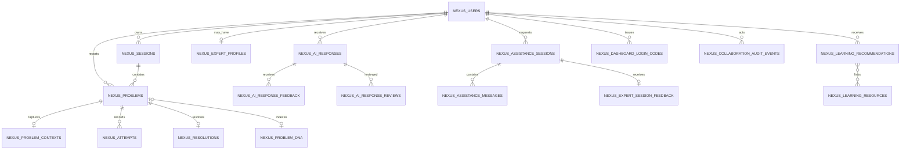

# NEXUS database schema

The Django model and migration files are authoritative. PostgreSQL is the normal shared database; SQLite remains a settings fallback for local development. ProblemDNA and Visual Expert embeddings are stored as JSON vectors and cosine-ranked in the backend; pgvector is not required for this implementation.

## Current entities

| Model / table | Purpose and important links |
| --- | --- |
| `NexusUser` / `nexus_users` | UUID identity, unique email, name, batch, active/staff/superuser flags. Authentication is email plus password and JWT. |
| `DashboardLoginCode` / `nexus_dashboard_login_codes` | Hashed one-time callback grant with exact redirect URI, allowed next path, expiry/use timestamps, and user FK. |
| `NexusSession` / `nexus_sessions` | Developer session/project label and active/closed timestamps. Owns problems. |
| `Problem` / `nexus_problems` | User/session issue, language/framework, category/type/severity, description, status, confidence. |
| `ProblemContext` / `nexus_problem_contexts` | One-to-one file name/path, selected and surrounding code, diagnostics. This is sensitive context; retain/share only under applicable consent and policy. |
| `Attempt` / `nexus_attempts` | Ordered diagnostic attempt, guidance level, reported result. |
| `ProblemResolution` / `nexus_resolutions` | One-to-one root cause, concept and verification state/details. |
| `ProblemDNA` / `nexus_problem_dna` | Structured symptom/pattern/attempt/guidance record, verification and sharing scope, reuse/reliability fields, normalized text and optional JSON embedding. Current retrieval is keyword overlap; embedding generation is disabled. |
| `AIResponse` / `nexus_ai_responses` | Stored AI answer JSON associated with user and optionally a problem/session. Feedback/review records link to the exact answer. |
| `AIResponseFeedback` / `nexus_ai_response_feedback` | Per-user response feedback; unique response/user pair. |
| `AIResponseReview` / `nexus_ai_response_reviews` | Separate review case/status/outcome/explanation/correction. It does not overwrite original answer content. |
| `ExpertProfile` / `nexus_expert_profiles` | One-to-one expert user, skills, availability and capacity. |
| `AssistanceSession` / `nexus_assistance_sessions` | Developer/expert request, lifecycle timestamps, approved context and resolution. States: pending, accepted, declined, cancelled, closed, expired. |
| `AssistanceMessage` / `nexus_assistance_messages` | Session-scoped private messages, ordered by creation. |
| `SessionFeedback` / `nexus_expert_session_feedback` | One developer rating/outcome feedback per assistance session. |
| `LearningRecommendation` / `nexus_learning_recommendations` | User-specific topic, evidence references, rationale, activity/progress status, and optional reviewed resources. |
| `LearningResource` / `nexus_learning_resources` | Admin-curated title/topic/technology/difficulty/objectives/URL/source and review state/date. New entries default to pending review; no course data was fabricated. |
| `VisualExpertKnowledge` / `nexus_visual_expert_knowledge` | Admin-curated technical excerpt and source reference, pending/approved/rejected state, reviewer, active flag, and optional Ollama embedding. Only active approved entries are visible to ordinary users. |
| `CollaborationAuditEvent` / `nexus_collaboration_audit_events` | Metadata-only collaboration/review event with actor, target, action and timestamp; does not duplicate messages or source content. |

Agent telemetry and other analytics-related models exist in `Backend/apps/agents/models.py`; consult the source for exact fields. Foreign-key deletion behavior follows model declarations and migrations. Django migration files are the source of truth for physical tables, indexes, constraints, and historical schema transitions.

## Retention and access notes

Problem context may contain source code and diagnostic output. Current application behavior should be reviewed before production use to confirm storage minimization, retention/deletion, and per-user access boundaries. Assistance context is explicitly opt-in in the current request flow. Feedback and reviewer corrections are separate linked records. Database backups must be access-controlled and covered by the same retention rules as the source database.

## Future schema changes

JSON vector lookup scans permitted records in application code. If data volume later requires pgvector indexing, choose dimensions, backfill and rollback procedures, and permission filters before a separate additive migration. Do not run destructive resets to adopt a new schema.
